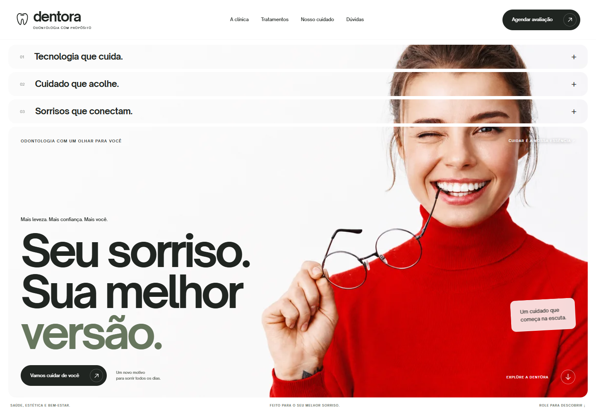

# Dentora — Um novo motivo para sorrir

Landing page de uma clínica odontológica **fictícia**, criada para portfólio. O projeto reúne interface editorial, galeria fotográfica, tratamentos, FAQ e uma simulação de agendamento. As fotos são ilustrativas e não representam pacientes ou profissionais da clínica.



## Como foi construída

- **React 19** para componentes e estados de navegação, FAQ, janelas e simulação de agendamento.
- **TypeScript** para tipar componentes, propriedades e dados da interface.
- **Vite** para desenvolvimento e build de produção.
- **Tailwind CSS** na configuração do projeto e CSS próprio em `src/index.css` para layout, tipografia, responsividade e movimento.
- Fotos locais em WebP e fontes **Open Sauce One** em WOFF2, servidas pela pasta `public/`.
- Design editável no [Figma](https://www.figma.com/design/QjM2BZaILsesbzrJWg5jIt).

## Animações e interações

- Splash de entrada com contador de 0 a 100, atualizado por `requestAnimationFrame` e exibido uma vez por sessão com `sessionStorage`.
- Entrada das seções ao rolar, usando `IntersectionObserver` e transições CSS.
- Cascata de elementos no hero e no menu móvel, com atrasos progressivos.
- Hover, sublinhados e expansão do FAQ feitos em CSS, sem biblioteca de animação.
- Mosaicos fotográficos com recortes responsivos e imagem compartilhada entre cartões.
- Janelas nativas `<dialog>` para tratamentos, privacidade e agendamento, com fechamento por Escape e retorno do foco.
- Suporte a `prefers-reduced-motion`, que remove animações não essenciais.

O formulário de agendamento apenas valida as escolhas e mostra um resumo. **Nenhuma consulta é marcada e nenhum dado é enviado a um servidor.**

O código da interface está em `src/App.tsx`, os estilos em `src/index.css` e as imagens e fontes em `public/`. O build gera um site estático em `dist/`. As decisões visuais estão registradas em `design/referencias.md`.

## Desenvolvimento

Com Node.js e npm instalados:

```sh
npm install
npm run dev
npm run build
```

O projeto também inclui lockfile do pnpm. Com pnpm: `pnpm install` e `pnpm run dev`.

## Publicação manual

Se o site aparecer sem imagens, consulte `design/COMO-CORRIGIR-A-HOSPEDAGEM.md`: a pasta `img` completa precisa ficar junto de `index.html`. O envio somente de HTML, CSS e JavaScript não inclui as fotografias.

Após `npm run build`, envie **o conteúdo de `dist/`** diretamente para a pasta pública da hospedagem, por exemplo `public_html`. O `index.html` precisa ficar na raiz dessa pasta, acompanhado por `style.css`, `script.js`, `404.html`, `robots.txt`, `img/` e `font/`. A hospedagem não precisa instalar Node, React ou dependências. O build também pode ser aberto diretamente por `index.html` no navegador.

Para editar, altere os arquivos em `src/` e rode o build novamente. Pacotes ZIP e arquivos gerados não são versionados neste repositório.

Antes de disponibilizar publicamente, configure o domínio, a URL absoluta da imagem de compartilhamento, canonical e sitemap. A versão de prévia tem `noindex, nofollow` e `robots.txt` bloqueando rastreamento: ajuste ambos se desejar indexar o portfólio. Configure a hospedagem para servir `404.html` com status HTTP 404 em endereços inexistentes; a configuração depende do servidor escolhido.

## O que funciona

- Navegação por âncoras, menu móvel e retorno ao topo.
- Mosaico fotográfico contínuo no desktop e abertura responsiva no celular.
- Splash na primeira visita da sessão, entradas ao rolar, cascata, hover e acordeão animado.
- Detalhes dos quatro tratamentos em janelas acessíveis.
- Demonstração de agendamento com validação, data mínima e resumo das preferências.
- Fechamento por Escape, foco contido nas janelas nativas e retorno do foco.
- FAQ com cinco perguntas, política de privacidade, página 404 e CTA móvel fixo.
- Respeito a `prefers-reduced-motion`.

## Limites intencionais

O agendamento **não marca consultas**. Não há backend, coleta de dados pessoais, WhatsApp real, endereço, equipe, avaliações ou atendimento médico. Todas as fotos são ilustrativas. Não há analytics nem cookies de rastreamento. Apenas a indicação de splash já exibida é guardada em `sessionStorage`.

As fontes Open Sauce One foram obtidas das URLs do briefing e agora estão no pacote como WOFF2. O rodapé traz o crédito exigido pela fonte. As fotos também estão locais; o retrato tem versões de 480, 800 e 1100 px para economizar transferência no celular. O Figma usa Inter como aproximação editável, pois Open Sauce One não estava disponível no editor conectado.

## Otimização

Os dois estilos externos de fontes foram substituídos por arquivos WOFF2 locais de 23 e 24 KB. O navegador começa a buscar a foto principal e as fontes assim que lê o HTML. As fotos fora da primeira tela continuam com carregamento tardio; o retrato seleciona a resolução pela largura e densidade da tela. Layout, conteúdo, splash, cascata, hover, acordeão e suporte a movimento reduzido foram mantidos. Nenhuma alteração foi enviada à hospedagem.

## Validação

Na preparação original, foram verificados o build de produção, TypeScript e testes no navegador com larguras de 320 a 1920 px, incluindo carregamento de imagens e fontes, menu, FAQ, janelas, simulação de agendamento, Escape e movimento reduzido.
